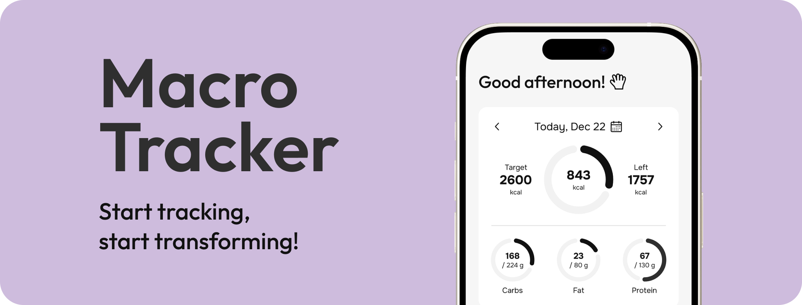
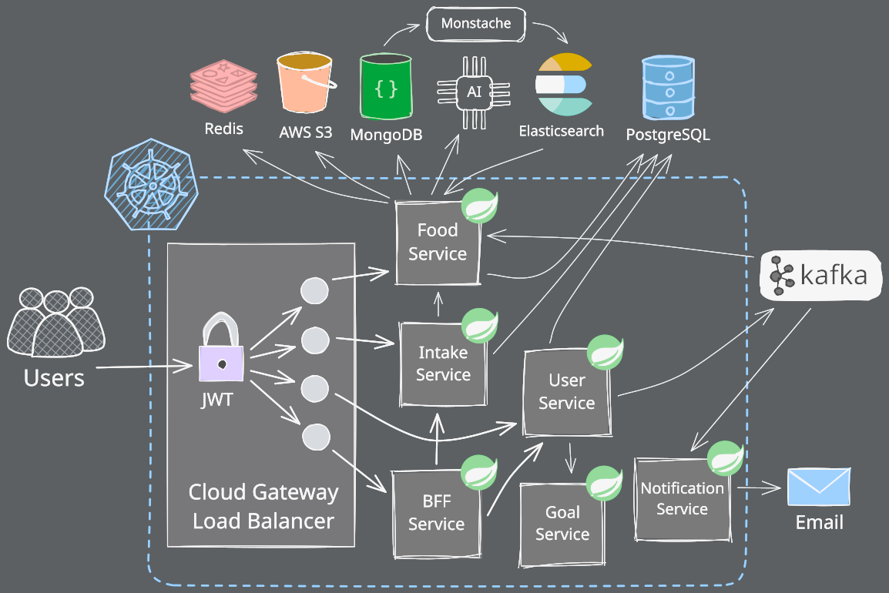

  

# Macro Tracker

***

**Macro Tracker is a nutrition tracking product for iOS and Android, with tools for logging meals, tracking calories and macros, and reviewing progress.**

Explore Macro Tracker on the official website and find the mobile apps on the App Store and Google Play using the links above. The backend microservice repositories are private; this repository provides a public overview of the platform and its architecture.

The mobile apps are backed by a distributed platform that supports **high availability**, eventual consistency, distributed tracing, and fault tolerance. The backend follows **12-Factor App** principles and runs on a bare-metal Kubernetes cluster.

## :chart_with_upwards_trend: Platform Scale & Performance

| Metric                 | Improvement                            | Technical Solution                                                                        |
|:-----------------------|:---------------------------------------|:------------------------------------------------------------------------------------------|
| **Data Scale**         | :file_folder: **2.8M+ Records**        | Efficient indexing of **2,800,000+** food items via **Elasticsearch** & **MongoDB**.      |
| **P99 Search Latency** | :zap: **< 400ms**                      | Sub-second fuzzy search across **2.8M+ items** using **Elasticsearch** inverted indexing. |
| **Infra Costs**        | :moneybag: **Cloud Cost Elimination**  | Deployed high-performance bare-metal infrastructure, eliminating cloud vendor costs.      |
| **API Latency**        | :arrow_down: **42% Reduction**         | Parallel execution via **Reactive BFF (WebFlux)** vs sequential blocking I/O.             |
| **Docker Size**        | :arrow_down: **59% Smaller**           | Migrated Java 21 Alpine images from JDK to JRE (from ~170MB to ~70MB).                    |
| **Deployment**         | :hourglass_flowing_sand: **4x Faster** | **Zero-touch CI/CD** pipeline reduces time-to-production to **< 5 minutes**.              |
| **Security**           | :lock: **Reduced Attack Surface**      | Minimized attack surface by using stripped-down Alpine Linux images.                      |
| **Availability**       | :white_check_mark: **99.9%**           | Redundant pod replicas managed by **Kubernetes HPA** and **Traefik** load balancing.      |

## :rocket: Backend Capabilities

* **Food Catalog & Search**: The catalog supports **2.8 Million+ documents**, with sub-second fuzzy search powered by Elasticsearch and food data stored in MongoDB.
* **Transactional Outbox Pattern**: Solves the "Dual Write" problem to ensure eventual consistency between PostgreSQL and Kafka. Guaranteed **zero data loss** even during broker outages.
* **High-Throughput Processing**: **Batch Processing** handles heavy writes, while **Recursive Deletion** strategies limit database lock contention and reduce transaction time.
* **Resilience**:
    * **Rate Limiting (Redis)**: Protects the system from DDoS and high load spikes.
    * **Idempotency & Retries**: Ensures data integrity during network failures or "double-click" scenarios, preventing duplicate records.
* **Infrastructure as Code**: Fully automated CI/CD pipelines and Kubernetes manifests for reproducible deployments.
* **Elastic Scalability**: **Kubernetes HPA** scales service replicas based on real-time CPU and memory utilization.
* **Traefik Ingress**: Manages external access and load balancing, decoupling routing logic from application code.
* **Bare-Metal Cluster**: Self-managed Kubernetes cluster running on **Alpine Linux** nodes, optimized for minimal resource footprint and hardened security.
* **Zero Trust Networking**: External access is secured via **Cloudflare Tunnels (Cloudflared)**. This eliminates the need for open firewall ports or static IPs, preventing DDoS attacks and hiding the origin server IP.

---

# :building_construction: Architecture & Infrastructure

### Core Components & Data Flow:
1.  **API Gateway (Spring Cloud Gateway)**: The entry point providing routing, **Redis-backed Rate Limiting**, and centralized JWT validation.
2.  **BFF Service (Backend for Frontend)**: Aggregates data from multiple downstream services (Intake, Goal) into optimized responses. Utilizes Reactive WebClient for non-blocking concurrent requests, reducing overall response time.
3.  **Event-Driven Core**: Asynchronous communication via **Apache Kafka** ensures service decoupling.
    * *Example*: When a user registers, an event is published. The **Notification Service** consumes it to send an email containing a verification code, without blocking the registration response.
4.  **Search Engine**: Food data is synced from MongoDB to **Elasticsearch** via **Monstache** (real-time oplog tailing) for high-performance fuzzy search.

---

# :brain: Backend Design & Reliability

The backend uses asynchronous messaging, transactional outbox publishing, and idempotent request handling to coordinate services and keep data consistent.

### 1. Data Consistency & Reliability
* **Transactional Outbox (Polling Publisher)**: To guarantee message delivery without distributed transactions (2PC), changes are first written to an `outbox` table in the same transaction as business data. A background job (using **ShedLock**) asynchronously pushes these events to Kafka.
* **Idempotency Strategy**: Critical write operations are protected by a custom AOP aspect (`@Idempotent`). It uses Redis to store unique request keys, preventing duplicate processing during network retries or "double-click" scenarios.

### 2. High-Performance Data Processing
* **Smart Batch Deletion**: To prevent **Kafka Consumer rebalancing storms** and database lock escalation during massive data cleanup (e.g., GDPR user deletion):
    * The Intake Service processes deletions in small, controlled **batches (chunks)**.
    * If a user has extensive data, the service employs a **Recursive Event pattern**: it deletes a chunk, then republishes the deletion event to process the next chunk, keeping transactions short and the consumer alive.

### 3. Asynchronous Notification System
* **Decoupled Email Delivery**: The **Notification Service** operates independently of the User Service. This ensures that slow SMTP servers or network timeouts do not impact the latency of user-facing operations (like Registration or Password Reset). If the mail server is down, Kafka guarantees the message is persisted and retried.

### 4. Caching & Persistence Strategy
* **Polyglot Persistence**:
    * **PostgreSQL**: For relational data (Users, Intakes).
    * **MongoDB**: For unstructured catalog data (Food items).
    * **AWS S3**: For storing food images.
* **Redis Tuning**: Configured with `allkeys-lfu` (Least Frequently Used) eviction policy to ensure the most popular food items and active user sessions remain in cache under memory pressure.

### 5. Security
* **Asymmetric JWT Signing (RS256)**: Instead of using shared secrets (Symmetric encryption), the system implements public/private key cryptography using **RSA keys**.
    * The **User Service** acts as the Identity Provider (IdP) and holds the **Private Key** to sign tokens.
    * The **API Gateway** acts as an OAuth2 Resource Server and validates signatures using the **Public Key**.
* **JWKS Endpoint**: Public keys are exposed via the standard `/.well-known/jwks.json` endpoint. This allows zero-downtime key rotation and enables other services (Gateway) to dynamically fetch current verification keys without redeployment.
* **Social Login Integration**: Server-side validation of Google and Facebook tokens ensures that third-party identity claims are trustworthy before issuing an internal JWT.
* **OAuth2 Audience Validation**: Strict audience (`aud`) validation for Google/Facebook tokens ensures the backend accepts tokens intended for the official Macro Tracker application, protecting against confused deputy attacks.
* **Optimized Stateless Auth**: Instead of heavy session management, a custom **JWT Filter Chain** performs signature validation at the Gateway level (Edge Authentication), offloading downstream services.
* **Strategy Pattern for Social Login**: A flexible design that validates OAuth2 tokens (Google, Facebook) server-side, enforcing a strict trust boundary.
* **Secret Management**: Strict separation of config and code. All sensitive credentials (DB passwords, API keys, OAuth secrets) are managed via **Kubernetes Secrets** and injected into containers as environment variables, ensuring no sensitive data is exposed in the source code.

### 6. Advanced Traffic Control (Rate Limiting)
* **Hybrid Key Resolution Strategy**: Instead of simple IP-based limiting (which penalizes users behind shared NATs), the Gateway implements a custom logic:
    * **Authenticated Users**: Rate limits are bucketed by **User ID**. This ensures fair usage per account regardless of their IP.
    * **Anonymous Traffic**: Falls back to **IP-based** limiting to protect public endpoints (like `/auth/login`) from brute-force and DDoS attacks.
* **Tiered Throttling**: Limits are granularly tuned via `application.yml` based on endpoint sensitivity:
    * **Critical**: Low throughput for auth routes (Login/Register) to prevent credential stuffing.
    * **Standard**: High throughput for read-heavy operations (Food Search).

### 7. Quality Assurance
* **Integration Testing**: **Testcontainers** runs isolated instances of PostgreSQL, MongoDB, and Redis to validate service behavior against the databases used in production.
* **RFC 7807 (Problem Details)**: All services return standardized JSON error responses, making client-side error handling predictable.
* **Shared Library**: Services reuse common DTOs, utilities, and exception handling configurations through a shared Maven library, keeping API contracts and error handling consistent.

---

# :bar_chart: Monitoring and Observability

* **OpenTelemetry Agents**: Attached to all pods for auto-instrumentation of traces and metrics.
* **Centralized & Structured Logging**: Services output logs in **JSON format** (via Logback/Logstash) for efficient parsing in the ELK Stack.
* **Health Checks**: **Spring Boot Actuator** exposes Liveness and Readiness probes, allowing K8s to automatically restart unhealthy pods or remove them from load balancing.
* **Distributed Tracing**: Full request visibility across microservices using Correlation IDs.

---

# :hammer_and_wrench: Technology Stack

| Category              | Technologies                                                                                                         |
|:----------------------|:---------------------------------------------------------------------------------------------------------------------|
| **Backend**           | Java 21, Spring Boot 3, Spring WebFlux (BFF), OpenFeign, MapStruct, Lombok, Actuator, Swagger, Maven, Logback, SLF4J |
| **Data & Storage**    | PostgreSQL, MongoDB, Redis, AWS S3, Liquibase                                                                        |
| **Messaging & Async** | Apache Kafka, Java Mail Sender, ShedLock (Distributed Locking)                                                       |
| **AI & Search**       | Google Gemini API, Elasticsearch, Monstache                                                                          |
| **DevOps & Infra**    | Kubernetes (K3s), Docker, GitHub Actions (CI/CD), Git Flow, HPA, Traefik, Cloudflare Tunnel, Alpine                  |
| **Observability**     | OpenTelemetry, ELK Stack (Elasticsearch, Logstash, Kibana), Uptime Monitor, Grafana, Alerting                        |
| **Testing**           | JUnit 5, Testcontainers, Mockito, MockMvc, Checkstyle                                                                |

---

| Resource       | Description                   | Link                                                                                     |
|:---------------|:------------------------------|:-----------------------------------------------------------------------------------------|
| **Website**    | Official Macro Tracker website | [Visit Website](https://macrotracker.uk/)                                                |
| **App Store**  | Macro Tracker for iOS          | [View on App Store](https://apps.apple.com/app/id6812871007)                               |
| **Google Play** | Macro Tracker for Android    | [View on Google Play](https://play.google.com/store/apps/details?id=com.olehprukhnytskyi.macrotracker) |
| **Swagger UI** | Interactive API Documentation | [Open Docs](https://macrotracker.uk/swagger-ui)                                          |

> **Note:** For private endpoints, you need to authorize using the `Bearer <token>` scheme.

    
    

---

## :balance_scale: License

Copyright (c) 2026 Oleh Prukhnytskyi. All rights reserved.

This repository and its contents are proprietary. See [LICENSE](../LICENSE) for details.
